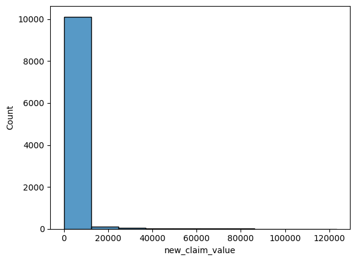
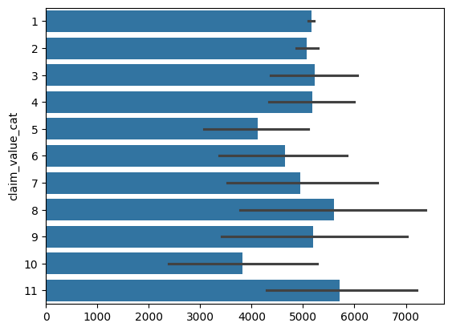
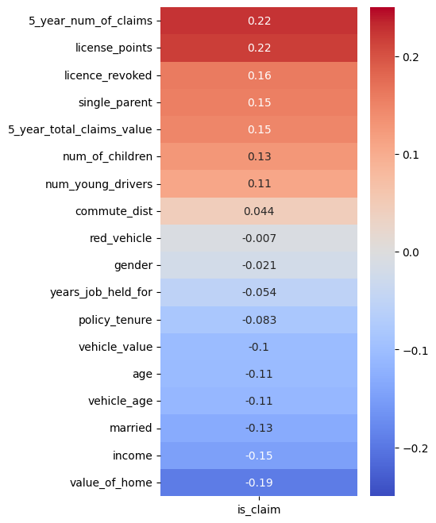
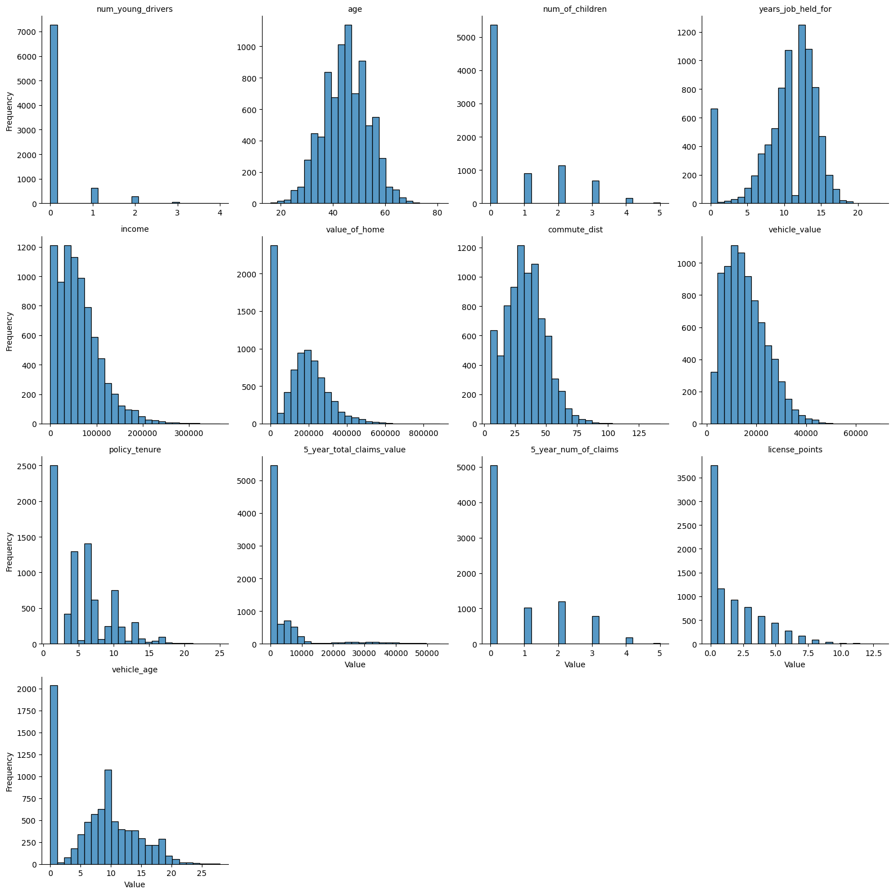
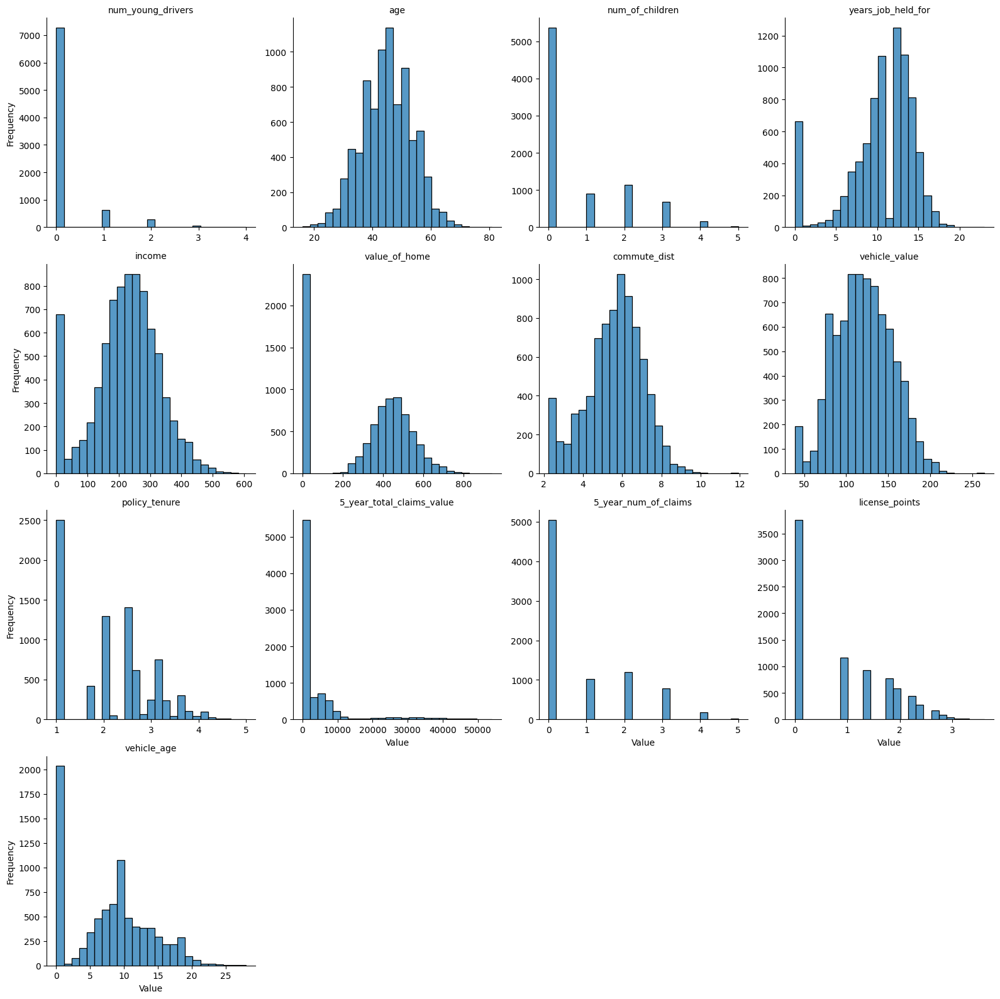
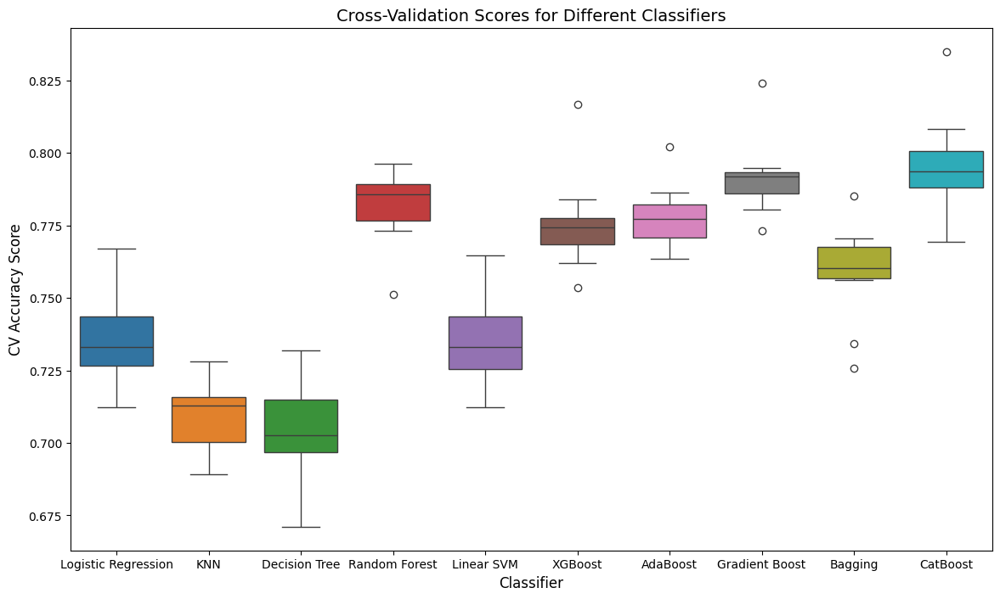
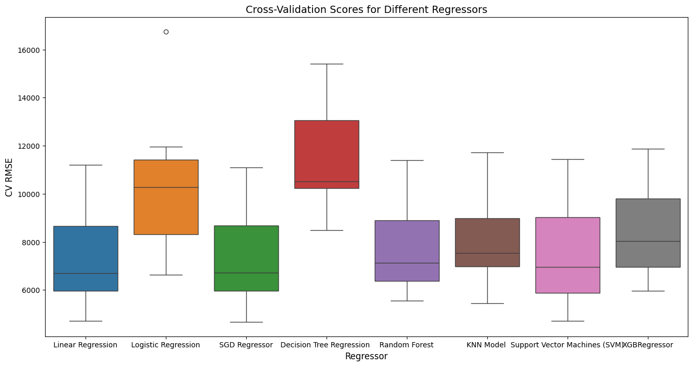
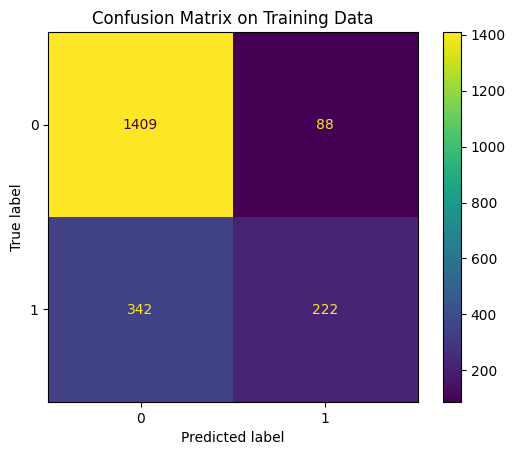

# Car Insurance Claim Prediction using XGBoost

A machine learning project that predicts two things for car insurance policyholders:

1. **Classification**: will the customer make a claim? (XGBoost classifier)
2. **Regression**: if a claim is made, how much will it cost? (SGD regressor)

The work covers data cleaning, exploratory data analysis, a scikit-learn preprocessing pipeline, model comparison, hyperparameter tuning and evaluation.

## Dataset

- **Source:** [Car Insurance Claim Data (Kaggle)](https://www.kaggle.com/datasets/xiaomengsun/car-insurance-claim-data)
- **Size:** 10,302 records, 27 columns, stored in `data/car_insurance_claim.csv`
- **Features:** age, income, gender, marital status, education, occupation, commute distance, vehicle type, vehicle value, claim history, licence points, and more
- **Targets:** `CLAIM_FLAG` (claim made: yes or no) and `CLM_AMT` (claim value)

## Project Structure

```
├── data/
│   └── car_insurance_claim.csv     # Raw dataset
├── images/                         # Plots exported from the notebook
├── main (1).ipynb                  # Full pipeline: cleaning → EDA → modelling → evaluation
├── test.ipynb                      # Practice notebook (data cleaning and train/test split)
└── car_insurance_dashboard.jsx     # React UI for entering customer details
```

## Workflow

### 1. Data Cleaning
- Renamed columns to readable names (for example, `KIDSDRIV` became `num_young_drivers`)
- Removed the one duplicate row
- Stripped `$` and `,` from the currency columns and converted them to integers
- Removed the `z_` prefix from categorical values
- Dropped `ID` and `date_of_birth`, which duplicates `age`

### 2. Stratified Train/Test Split
The claim value is heavily right-skewed, so it was grouped into bins and the 80/20 split was stratified on those bins. Both sets end up with a similar share of claims (26.5% train, 27.4% test).

| Claim value distribution | Stratification bins |
|---|---|
|  |  |

### 3. Exploratory Data Analysis
The heatmap below shows how each feature correlates with `is_claim`. Claim history, licence points, a revoked licence, single-parent status and commute distance correlate most positively. `red_vehicle` shows almost no correlation, so it was dropped.

<p align="center"></p>

### 4. Preprocessing Pipeline
A scikit-learn `ColumnTransformer` pipeline with these steps:
- **Numerical:** KNN imputation, square-root transform on skewed features, then `StandardScaler`
- **Ordinal** (education level): `OrdinalEncoder` with an explicit ranking
- **Binary:** `OrdinalEncoder`
- **Nominal** (occupation, vehicle type): `OneHotEncoder`, with one reference category dropped to avoid the dummy variable trap (checked with VIF)
- A custom `ColumnDropper` transformer and a custom `SqrtTransformer`

| Before transform | After square-root transform |
|---|---|
|  |  |

### 5. Classification: Model Selection
Ten classifiers were compared with 10-fold cross-validation. CatBoost and Gradient Boosting scored slightly higher, but **XGBoost** was chosen because it tunes much faster.



### 6. Hyperparameter Tuning
Tuning had two stages: `RandomizedSearchCV` with 2,000 candidates to cover a wide range, then `GridSearchCV` with 729 candidates around the best region.

Best parameters:
```python
{'colsample_bytree': 0.5, 'gamma': 0.15, 'learning_rate': 0.04, 'max_depth': 6,
 'min_child_weight': 18, 'n_estimators': 300, 'reg_alpha': 1, 'reg_lambda': 1, 'subsample': 0.55}
```

### 7. Regression: Claim Value
Using only the records that had a claim, eight regressors were compared on RMSE. Linear Regression and the SGD Regressor did best. The SGD Regressor was chosen and tuned with random search followed by grid search.



## Results

### Classification (XGBoost)
| Metric | Score |
|---|---|
| CV score, default hyperparameters | 0.779 |
| CV weighted F1, tuned | 0.785 |
| **Test weighted F1** | **0.769** |
| **Test accuracy** | **79.1%** |

<p align="center"></p>

The confusion matrix above is for the test set; the title inside the image is wrong. The model identifies non-claims well (1,409 of 1,497). Recall on actual claims is lower (222 of 564), so class balancing or threshold tuning would be the next thing to improve.

### Regression (SGD Regressor)
| Metric | Score |
|---|---|
| Test RMSE | $8,384 |
| Test MAE | $3,516 |

## Dashboard

`car_insurance_dashboard.jsx` is a React interface for entering a customer's details and viewing a risk assessment. It currently gets its predictions by sending the inputs to an LLM API, not to the trained XGBoost model. Serving the trained model through an API would be a natural next step.

## Getting Started

```bash
git clone https://github.com/qzaman243/Car-insurance-claim-prediction-by-using-XGBoost.git
cd Car-insurance-claim-prediction-by-using-XGBoost
pip install pandas numpy seaborn matplotlib scikit-learn xgboost catboost statsmodels scipy jupyter
jupyter notebook "main (1).ipynb"
```

## Future Improvements
- Handle class imbalance (`scale_pos_weight`, SMOTE) to improve recall on claims
- Analyse feature importance with SHAP
- Build an ensemble from XGBoost, CatBoost and Gradient Boosting
- Fit the preprocessing pipeline on training data only, then call `transform` on the test set
- Connect the dashboard to the trained model

## Author
**Qamar Zaman** ([@qzaman243](https://github.com/qzaman243))
